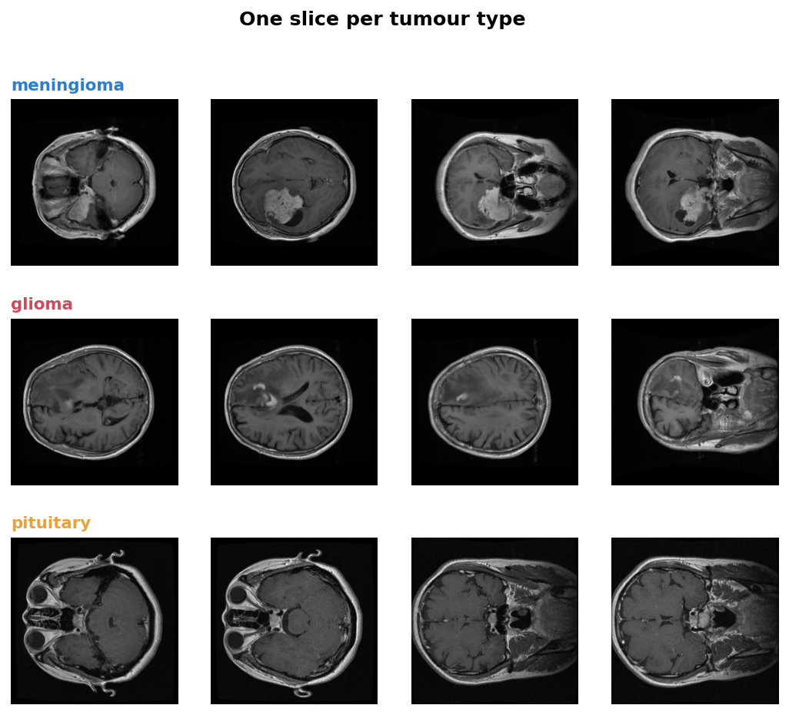
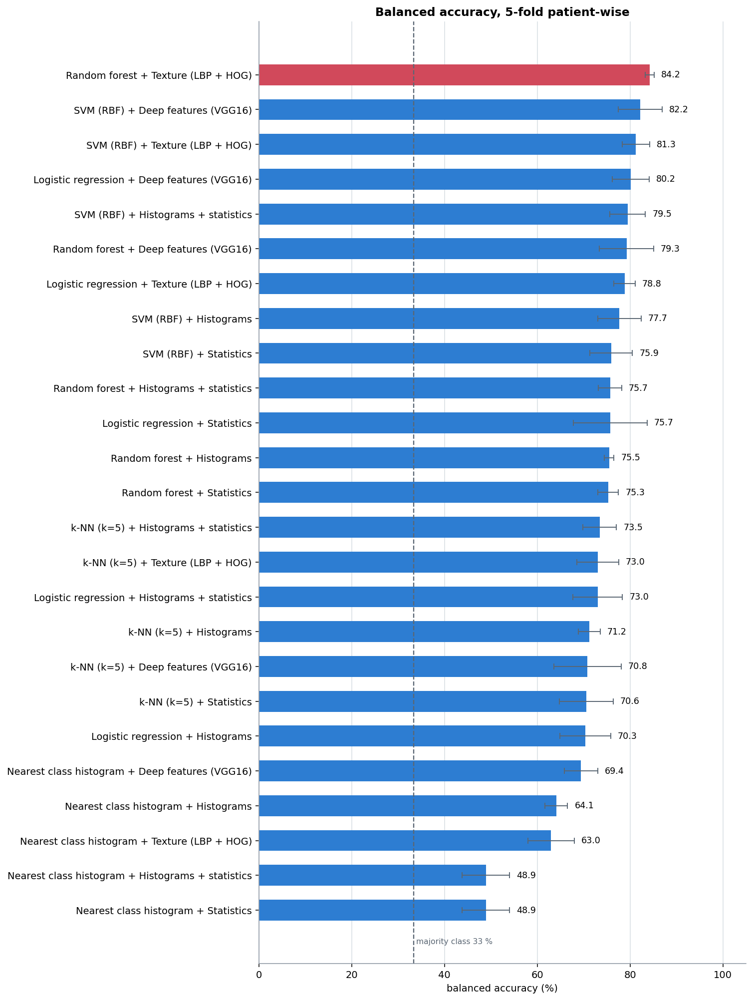
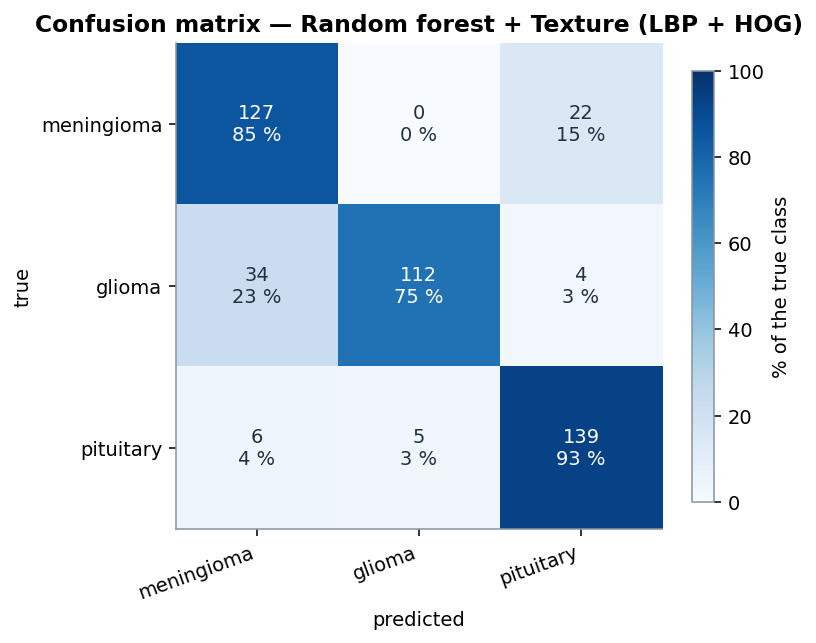
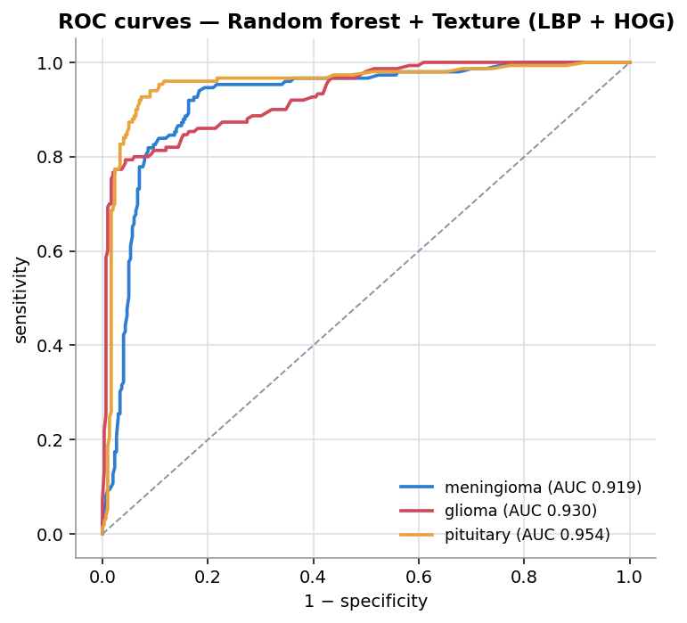
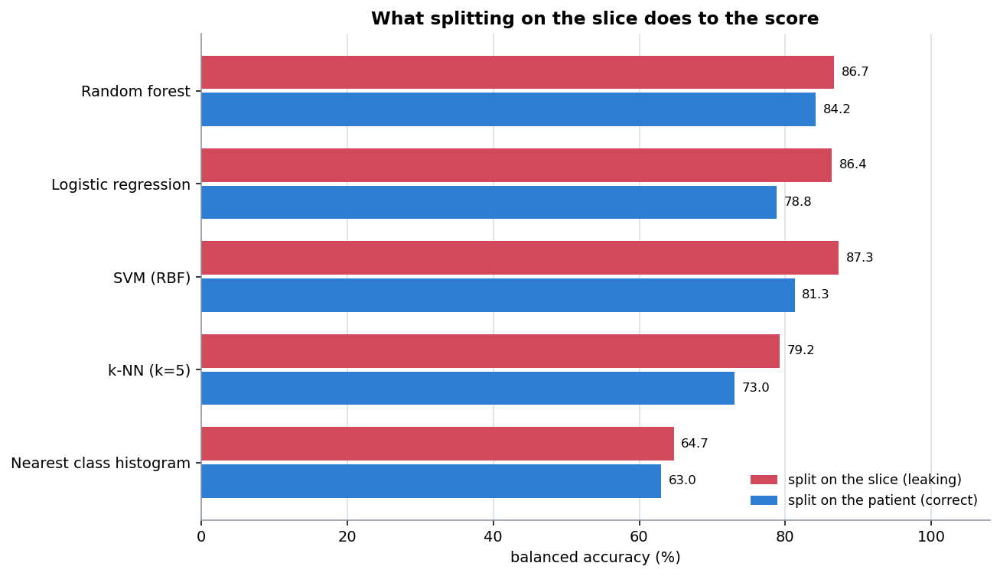
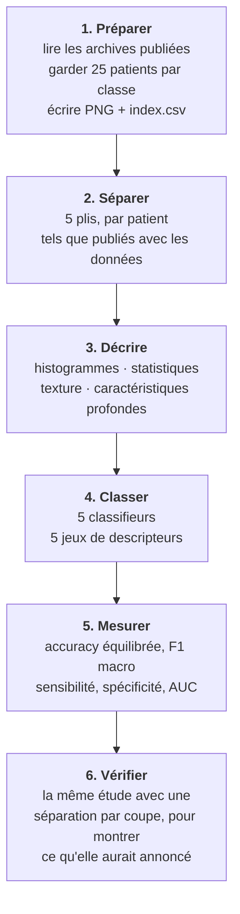

<div align="center">

# NeuroScan

### Classer les tumeurs cérébrales sur IRM — et le mesurer honnêtement

[🇬🇧 English](README.md) · 🇫🇷 Français

[](https://www.python.org)
[](https://scikit-learn.org)
[](https://www.tensorflow.org)
[](tests)
[](data/README.md)
[](LICENSE)
[](#-contexte-du-projet)



**Trois types de tumeur, 449 coupes IRM, 75 patients, 25 combinaisons de modèles — évalués avec des plis qui ne séparent jamais un patient.**

[📓 Lire le notebook](notebooks/neuroscan_analysis.ipynb) · [🔬 Méthodes](docs/fr/methodes.md) · [📊 Résultats](docs/fr/resultats.md) · [💻 Code source](docs/fr/code-source.md)

</div>

---

## Sommaire

- [Présentation](#-présentation)
- [Contexte du projet](#-contexte-du-projet)
- [Résultats](#-résultats)
- [L'erreur autour de laquelle ce projet est construit](#-lerreur-autour-de-laquelle-ce-projet-est-construit)
- [Ce qui est implémenté](#-ce-qui-est-implémenté)
- [Déroulement de l'étude](#-déroulement-de-létude)
- [Démarrage](#-démarrage)
- [Structure du projet](#-structure-du-projet)
- [Tests](#-tests)
- [Limites](#-limites)
- [Documentation](#-documentation)
- [Références](#-références)
- [Licence](#-licence)

---

## 🎯 Présentation

**NeuroScan** classe une coupe IRM cérébrale en trois types de tumeur — **méningiome**,
**gliome** ou **tumeur pituitaire** — et compare les façons d'y parvenir, d'une règle sur
histogrammes tenant en quelques lignes aux caractéristiques profondes d'un réseau
pré-entraîné.

L'objet du projet n'est pas le meilleur score, mais **que le score soit réel**. Plusieurs
coupes proviennent du même patient et se ressemblent énormément : séparer les coupes au
hasard place donc des quasi-copies d'une image d'entraînement dans le jeu de test. La
précision mesurée grimpe alors de plusieurs points sans raison. Tous les chiffres
ci-dessous viennent de plis qui gardent toutes les coupes d'un patient du même côté.

| | |
|---|---|
| **Tâche** | Classification en trois classes d'une coupe IRM cérébrale |
| **Données** | 449 coupes, 75 patients, 25 par classe — jeu public sous CC BY 4.0 |
| **Descripteurs** | Histogrammes par région · statistiques d'intensité · texture LBP + HOG · caractéristiques VGG16 |
| **Classifieurs** | Plus proche moyenne de classe · k-NN · SVM · régression logistique · forêt aléatoire |
| **Évaluation** | Validation croisée 5 plis, par patient, avec les plis publiés avec le jeu de données |
| **Meilleur résultat** | **84,2 % d'accuracy équilibrée**, F1 macro 0,842, AUC 0,935 |
| **Référence** | 33,4 % (toujours répondre la classe la plus fréquente) |

## 🧩 Contexte du projet

NeuroScan est un **projet personnel**, réalisé en **2025** pour apprendre l'analyse
d'images médicales. Il a commencé par quelques scripts comparant des histogrammes de
niveaux de gris, puis est devenu une vraie étude : mêmes données, mêmes plis et mêmes
métriques pour chaque méthode, pour que la comparaison ait un sens.

Y travailler m'a appris la leçon autour de laquelle tout le dépôt est organisé : en
imagerie médicale, **la façon de séparer les données compte plus que le choix du modèle**.

## 📊 Résultats

### 25 combinaisons, une seule évaluation

Cinq jeux de descripteurs × cinq classifieurs, tous sur les mêmes plis par patient :

| Descripteurs | Meilleur classifieur | Accuracy équilibrée | F1 macro | AUC | Temps |
|---|---|---|---|---|---|
| **Texture (LBP + HOG)** | **Forêt aléatoire** | **84,2 %** | **0,842** | **0,935** | 5,8 s |
| Caractéristiques VGG16 | SVM (RBF) | 82,2 % | 0,822 | 0,929 | 1,0 s |
| Histogrammes + statistiques | SVM (RBF) | 79,5 % | 0,793 | 0,907 | 1,3 s |
| Histogrammes | SVM (RBF) | 77,7 % | 0,774 | 0,899 | 1,1 s |
| Statistiques d'intensité | SVM (RBF) | 75,9 % | 0,758 | 0,895 | 0,4 s |



**La texture bat ici les caractéristiques profondes.** Décrire l'agencement des pixels —
motifs binaires locaux et orientations des gradients — fonctionne mieux sur 449 images que
les activations d'un réseau entraîné sur des photographies. Avec quelques milliers de
coupes, le classement s'inverserait probablement ; avec quelques centaines, un descripteur
compact fait main est le meilleur choix. Le temps de calcul diffère aussi de deux ordres
de grandeur une fois l'extraction comptée.

### Ce que le meilleur modèle réussit et rate

| Classe | Sensibilité | Spécificité | F1 |
|---|---|---|---|
| Méningiome | 85,2 % | 86,7 % | 0,804 |
| Gliome | 74,7 % | **98,3 %** | 0,839 |
| Pituitaire | **92,7 %** | 91,3 % | 0,883 |

<p align="center">


</p>

Les erreurs ne sont pas aléatoires. **34 gliomes sont lus comme des méningiomes**, alors que
l'inverse n'arrive presque jamais : le modèle est prudent avant d'annoncer un gliome, d'où
une spécificité de 98,3 % mais une sensibilité de seulement 74,7 %. Les tumeurs pituitaires
occupent une position très caractéristique à la base du crâne et forment la classe la plus
facile.

L'accuracy seule aurait masqué tout cela : c'est pourquoi elle n'est jamais donnée seule
ici.

## ⚠ L'erreur autour de laquelle ce projet est construit

Une séparation aléatoire des 449 coupes place **68 des 75 patients des deux côtés** à la
fois. Le jeu de test contient alors d'autres coupes de patients que le modèle a déjà vus :
presque la même image, quelques millimètres plus haut dans le crâne.



| Classifieur | Par patient (correct) | Par coupe (fuite) | Gonflement |
|---|---|---|---|
| Plus proche moyenne | 63,0 % | 64,7 % | +1,8 |
| k-NN (k=5) | 73,0 % | 79,2 % | **+6,2** |
| SVM (RBF) | 81,3 % | 87,3 % | **+6,0** |
| Régression logistique | 78,8 % | 86,4 % | **+7,6** |
| Forêt aléatoire | 84,2 % | 86,7 % | +2,5 |

Même code, mêmes descripteurs, même modèle — **+4,8 points en moyenne, jusqu'à +7,6**, à
cause d'une seule ligne décidant comment les données sont séparées. Un chiffre publié à
87 % serait indéfendable, et rien dans la sortie ne l'aurait signalé.

À essayer soi-même : `python scripts/03_leakage_demo.py`.

## 🔬 Ce qui est implémenté

### Décrire une image

| Descripteurs | Module | Idée | Taille |
|---|---|---|---|
| **Histogrammes par région** | [`features.py`](neuroscan/features.py) | Histogramme des niveaux de gris de chaque case d'une grille 4 × 4 | 512 |
| **Statistiques d'intensité** | [`features.py`](neuroscan/features.py) | Moyenne, dispersion, asymétrie, aplatissement, entropie par case | 80 |
| **Texture (LBP + HOG)** | [`texture.py`](neuroscan/texture.py) | Comment les pixels sont agencés, et dans quelle direction courent les contours | 1 924 |
| **Caractéristiques profondes** | [`deep.py`](neuroscan/deep.py) | Activations moyennées de VGG16 pré-entraîné sur ImageNet | 512 |

### Classer

| Classifieur | Remarque |
|---|---|
| **Plus proche moyenne de classe** | Codé de zéro — la règle d'où est parti ce projet |
| k-NN, SVM (RBF), régression logistique, forêt aléatoire | scikit-learn, pondérés par classe |

La plus proche moyenne de classe est conservée volontairement : c'est l'idée d'origine,
c'est le modèle le plus faible du tableau, et la montrer rend mesurable l'apport de tout
le reste.

## ⚙ Déroulement de l'étude



Trois décisions portent toute l'étude.

**L'unité est le patient, pas la coupe.** Chaque séparation passe par un contrôle qui lève
une erreur si un patient apparaît des deux côtés, et la validation croisée utilise les 5
plis publiés avec le jeu de données, construits patient par patient.

**Une ligne par image, jamais par région.** Découper une image en régions est une façon de
la décrire, pas une façon de fabriquer plus de données. Traiter chaque région comme un
échantillon indépendant est une seconde fuite, plus discrète.

**Des métriques équilibrées, toujours.** Avec trois classes mal réparties, un modèle qui
ignore une classe peut encore afficher une accuracy correcte. L'accuracy équilibrée, le F1
macro et les sensibilité et spécificité par classe sont donnés ensemble, jamais l'un seul.

## 🚀 Démarrage

```bash
git clone https://github.com/aminehemmaz/NeuroScan.git
cd NeuroScan
pip install -r requirements.txt
```

Les 449 coupes sont dans le dépôt : l'étude s'exécute hors ligne.

```bash
python scripts/02_compare_models.py      # les 20 combinaisons faites main, ~4 min
python scripts/03_leakage_demo.py        # la comparaison par patient / par coupe
```

Les caractéristiques profondes demandent TensorFlow, qui est optionnel :

```bash
pip install tensorflow-cpu
python scripts/02_compare_models.py --with-deep      # ajoute VGG16, ~7 min de plus
```

Ou ouvrez le notebook, qui déroule toute l'étude :

```bash
jupyter lab notebooks/neuroscan_analysis.ipynb
```

Pour reconstruire le jeu d'images depuis les archives d'origine, voir
[`data/README.md`](data/README.md#données).

## 📁 Structure du projet

```text
NeuroScan/
├── neuroscan/               # Le package
│   ├── dataset.py             # chargement, séparations par patient, contrôles de fuite
│   ├── features.py            # histogrammes par région et statistiques d'intensité
│   ├── texture.py             # motifs binaires locaux, histogrammes de gradients
│   ├── deep.py                # caractéristiques VGG16 (optionnel)
│   ├── models.py              # les classifieurs et la boucle d'évaluation
│   ├── evaluation.py          # accuracy équilibrée, F1, sensibilité, spécificité, AUC
│   └── plotting.py            # figures
├── scripts/                 # 1. préparer  2. comparer  3. démonstration de la fuite
├── tests/                   # 44 tests, dont ceux qui protègent les séparations
├── notebooks/               # notebook de démonstration exécuté
├── data/                    # 449 coupes + index.csv (voir data/README.md)
├── results/                 # tableaux de comparaison, métriques par classe, fuite
└── docs/                    # documentation (anglais) et figures
    └── fr/                    # documentation (français)
```

## ✅ Tests

```bash
pytest -q
```

```text
44 passed
```

Les tests portent sur ce qui casserait silencieusement un résultat médical :

- **Un patient ne doit jamais traverser un pli.** Testé sur chaque pli de la validation
  croisée, et la fonction qui lève une erreur en cas de chevauchement est testée dans les
  deux sens.
- **La séparation volontairement fausse doit l'être vraiment**, sinon la démonstration de
  la fuite ne prouverait rien.
- **L'accuracy équilibrée doit punir un modèle paresseux** : 90 cas fréquents et 10 rares,
  tous prédits fréquents, donne 90 % d'accuracy et 50 % d'accuracy équilibrée.
- **Les métriques par classe sont vérifiées sur une matrice de confusion calculée à la
  main.**
- **La plus proche moyenne doit moyenner toutes les images d'entraînement**, ce qui est
  précisément le bug de la première version de ce projet.
- **Les régions doivent couvrir toute l'image**, y compris quand le côté n'est pas
  divisible par la taille de la grille.
- **Le LBP doit être invariant à un décalage de luminosité**, hors de la bordure où le
  remplissage le fait légitimement différer.

## ⚠ Limites

- **449 coupes, 75 patients.** De quoi comparer des méthodes équitablement, pas de quoi
  revendiquer un résultat clinique. L'intervalle de confiance autour de 84,2 % couvre
  plusieurs points.
- **Une seule source.** Toutes les images viennent de deux hôpitaux en Chine, avec un seul
  protocole (T1 avec injection). Un autre appareil ou une autre population pourrait
  changer le classement.
- **Ce sont des coupes, pas des patients, qui sont classées.** Un outil clinique
  trancherait par patient, en utilisant toutes les coupes de l'examen ensemble.
- **La tumeur n'est pas localisée.** Le jeu de données fournit un masque de tumeur pour
  chaque coupe ; il est conservé dans l'index mais non exploité. La segmentation est la
  suite naturelle.
- **Pas de recherche d'hyperparamètres.** Des valeurs par défaut raisonnables sont
  utilisées pour tous les modèles, à l'identique, pour que la comparaison soit équitable
  plutôt qu'optimisée. Un réglage dans la validation croisée demanderait une boucle
  imbriquée.
- **Pas de validation externe.** L'étape honnête suivante serait un second jeu de données
  d'un autre hôpital, ce qui coûte en général plusieurs points.

**Il s'agit d'un projet d'étude, pas d'un dispositif médical.** Rien ici ne doit servir à
orienter un diagnostic.

## 📚 Documentation

| Document | English | Français |
|---|---|---|
| Méthodes et imagerie médicale | [methods.md](docs/methods.md) | [methodes.md](docs/fr/methodes.md) |
| Résultats détaillés | [results.md](docs/results.md) | [resultats.md](docs/fr/resultats.md) |
| Code source expliqué | [source-code.md](docs/source-code.md) | [code-source.md](docs/fr/code-source.md) |
| Données et leurs limites | [data/README.md](data/README.md) | [data/README.md](data/README.md#données) |

## 📖 Références

- Cheng, J. *et al.* (2015). *Enhanced performance of brain tumor classification via tumor
  region augmentation and partition.* PLoS ONE 10(10). — le jeu de données utilisé ici.
- Cheng, J. *et al.* (2016). *Retrieval of brain tumors by adaptive spatial pooling and
  Fisher vector representation.* PLoS ONE 11(6).
- Ojala, T., Pietikäinen, M. et Mäenpää, T. (2002). *Multiresolution gray-scale and
  rotation invariant texture classification with local binary patterns.* IEEE TPAMI.
- Dalal, N. et Triggs, B. (2005). *Histograms of oriented gradients for human detection.*
  CVPR.
- Simonyan, K. et Zisserman, A. (2015). *Very deep convolutional networks for large-scale
  image recognition.* ICLR. — l'architecture VGG16.
- Varoquaux, G. et Cheplygina, V. (2022). *Machine learning for medical imaging:
  methodological failures and recommendations for the future.* npj Digital Medicine. — sur
  la fuite de données et les résultats trop optimistes.

## 📜 Licence

Le code, la documentation et les figures sont publiés sous **[licence MIT](LICENSE)**.

Les coupes IRM de `data/` proviennent du jeu de données de tumeurs cérébrales de Jun Cheng,
publié sur Figshare sous **CC BY 4.0** et redistribué ici avec attribution. Voir
[NOTICE.md](NOTICE.md) et [data/README.md](data/README.md#données) pour la citation et les
conditions.

> **Ceci est un projet d'étude, pas un dispositif médical.** Il n'a fait l'objet d'aucune
> validation clinique.
