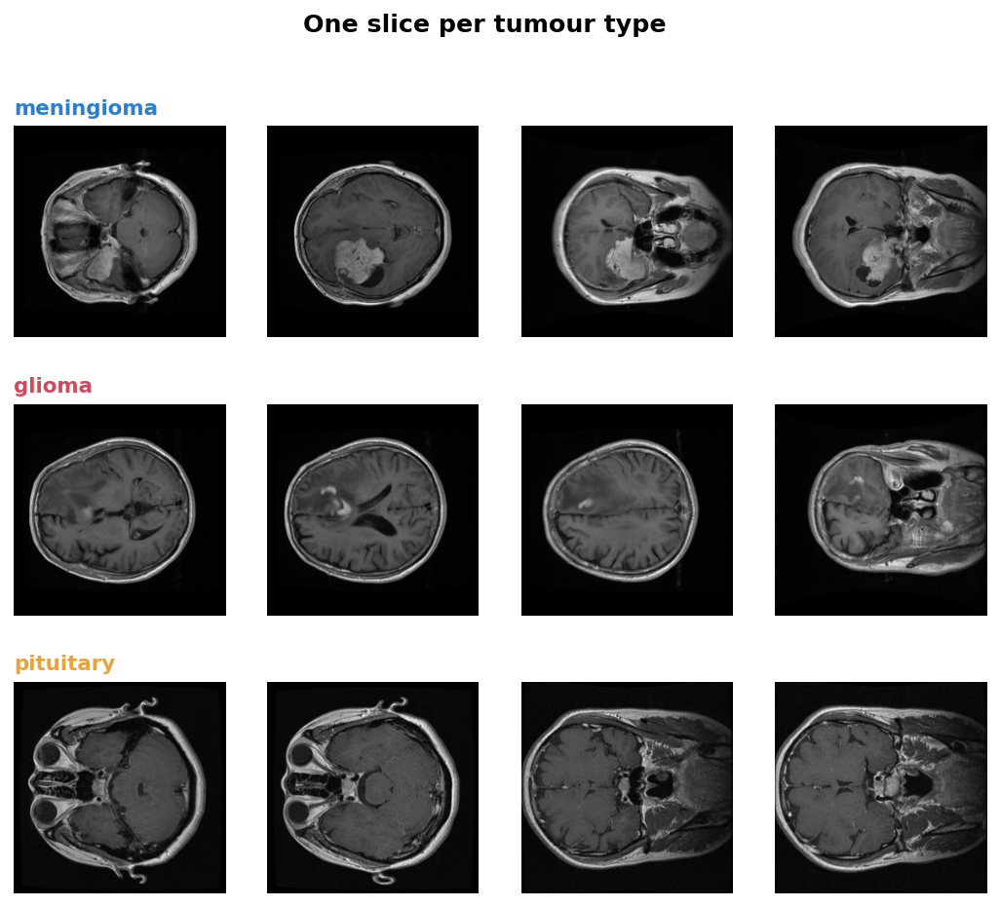
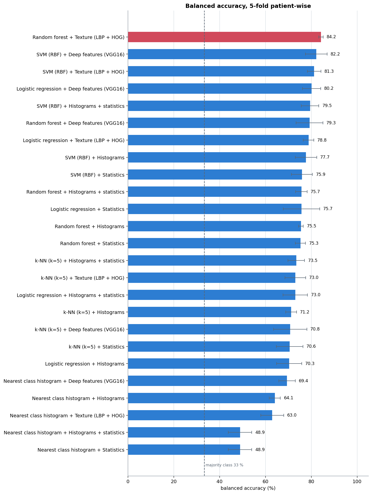
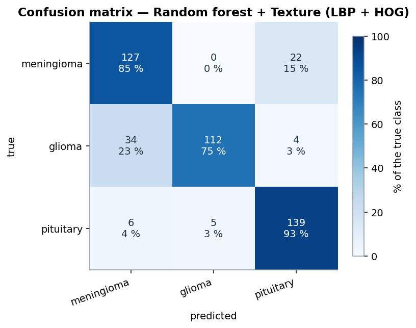
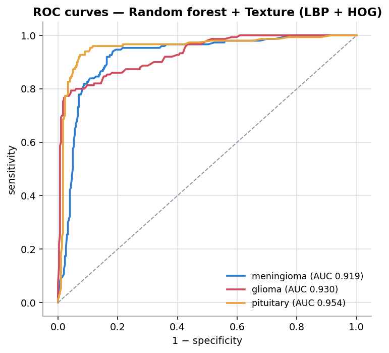
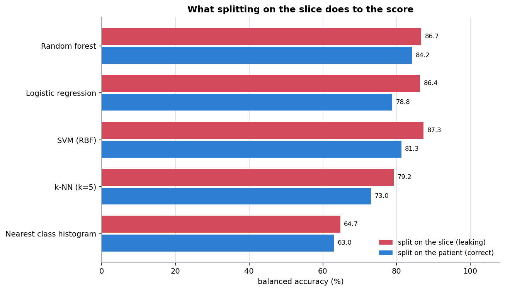
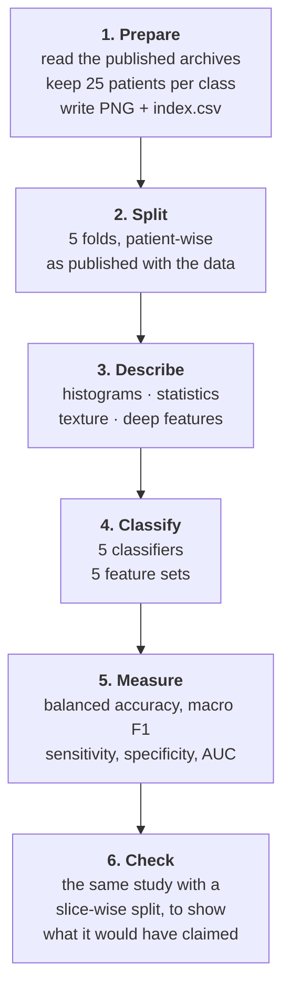

<div align="center">

# NeuroScan

### Classifying brain tumours on MRI — and measuring it honestly

🇬🇧 English · [🇫🇷 Français](README.fr.md)

[](https://www.python.org)
[](https://scikit-learn.org)
[](https://www.tensorflow.org)
[](tests)
[](data/README.md)
[](LICENSE)
[](#-project-background)



**Three tumour types, 449 MRI slices, 75 patients, 25 model combinations — evaluated with folds that never split a patient.**

[📓 Read the notebook](notebooks/neuroscan_analysis.ipynb) · [🔬 Methods](docs/methods.md) · [📊 Results](docs/results.md) · [💻 Source code](docs/source-code.md)

</div>

---

## Contents

- [Overview](#-overview)
- [Project background](#-project-background)
- [Results](#-results)
- [The mistake this project is built around](#-the-mistake-this-project-is-built-around)
- [What is implemented](#-what-is-implemented)
- [How the study runs](#-how-the-study-runs)
- [Getting started](#-getting-started)
- [Project structure](#-project-structure)
- [Tests](#-tests)
- [Limitations](#-limitations)
- [Documentation](#-documentation)
- [References](#-references)
- [Licence](#-licence)

---

## 🎯 Overview

**NeuroScan** classifies a brain MRI slice into one of three tumour types — **meningioma**,
**glioma** or **pituitary tumour** — and compares the ways of doing it, from a histogram
rule written in a few lines to deep features taken from a pre-trained network.

The point of the project is not the best score. It is **the score being real**. Several
slices come from the same patient and look almost alike, so splitting slices at random
puts near-copies of a training image into the test set. The measured accuracy then goes up
by several points for no reason. Every number below comes from folds that keep all the
slices of a patient on the same side.

| | |
|---|---|
| **Task** | Three-class classification of a brain MRI slice |
| **Data** | 449 slices, 75 patients, 25 per class — from a public CC BY 4.0 dataset |
| **Features** | Regional histograms · intensity statistics · LBP + HOG texture · VGG16 deep features |
| **Classifiers** | Nearest class mean · k-NN · SVM · logistic regression · random forest |
| **Evaluation** | 5-fold cross-validation, patient-wise, with the folds published with the dataset |
| **Best result** | **84.2 % balanced accuracy**, macro F1 0.842, AUC 0.935 |
| **Baseline** | 33.4 % (always answer the most frequent class) |

## 🧩 Project background

NeuroScan is a **personal project**, built in **2025** to learn medical image analysis. It
started as a handful of scripts that compared grey-level histograms, then grew into a
proper study: the same data, the same folds and the same metrics for every method, so the
comparison means something.

Working on it taught the lesson the whole repository is organised around — that in medical
imaging, **how you split the data matters more than which model you pick**.

## 📊 Results

### 25 combinations, one evaluation

Five feature sets × five classifiers, all on the same patient-wise folds:

| Feature set | Best classifier | Balanced accuracy | Macro F1 | AUC | Fit time |
|---|---|---|---|---|---|
| **Texture (LBP + HOG)** | **Random forest** | **84.2 %** | **0.842** | **0.935** | 5.8 s |
| Deep features (VGG16) | SVM (RBF) | 82.2 % | 0.822 | 0.929 | 1.0 s |
| Histograms + statistics | SVM (RBF) | 79.5 % | 0.793 | 0.907 | 1.3 s |
| Histograms | SVM (RBF) | 77.7 % | 0.774 | 0.899 | 1.1 s |
| Intensity statistics | SVM (RBF) | 75.9 % | 0.758 | 0.895 | 0.4 s |



**Texture beats deep features here.** Describing how the pixels are arranged — local binary
patterns and gradient orientations — works better on 449 images than the activations of a
network trained on photographs. With a few thousand slices the ranking would likely flip;
with a few hundred, a compact handcrafted descriptor is the stronger choice. The fit time
also differs by two orders of magnitude once feature extraction is counted.

### What the best model gets right and wrong

| Class | Sensitivity | Specificity | F1 |
|---|---|---|---|
| Meningioma | 85.2 % | 86.7 % | 0.804 |
| Glioma | 74.7 % | **98.3 %** | 0.839 |
| Pituitary | **92.7 %** | 91.3 % | 0.883 |

<p align="center">


</p>

The errors are not random. **34 gliomas are read as meningiomas**, while the reverse almost
never happens: the model is cautious about calling a glioma, which is why its specificity
is 98.3 % but its sensitivity only 74.7 %. Pituitary tumours sit in a distinctive place at
the base of the skull and are the easiest class.

Accuracy alone would have hidden all of this, which is why it is never reported on its own
here.

## ⚠ The mistake this project is built around

A random split of the 449 slices puts **68 of the 75 patients on both sides** at once. The
test set then contains other slices of patients the model has already seen — nearly the
same image, a few millimetres higher in the skull.



| Classifier | Patient-wise (correct) | Slice-wise (leaking) | Inflation |
|---|---|---|---|
| Nearest class mean | 63.0 % | 64.7 % | +1.8 |
| k-NN (k=5) | 73.0 % | 79.2 % | **+6.2** |
| SVM (RBF) | 81.3 % | 87.3 % | **+6.0** |
| Logistic regression | 78.8 % | 86.4 % | **+7.6** |
| Random forest | 84.2 % | 86.7 % | +2.5 |

Same code, same features, same model — **+4.8 points on average, up to +7.6**, from one
line deciding how the data is split. A published figure of 87 % would be indefensible, and
nothing in the output would have signalled it.

Run it yourself: `python scripts/03_leakage_demo.py`.

## 🔬 What is implemented

### Describing an image

| Features | Module | Idea | Size |
|---|---|---|---|
| **Regional histograms** | [`features.py`](neuroscan/features.py) | Grey-level histogram of each cell of a 4 × 4 grid | 512 |
| **Intensity statistics** | [`features.py`](neuroscan/features.py) | Mean, spread, skewness, kurtosis, entropy per cell | 80 |
| **Texture (LBP + HOG)** | [`texture.py`](neuroscan/texture.py) | How pixels are arranged, and in which direction the edges run | 1 924 |
| **Deep features** | [`deep.py`](neuroscan/deep.py) | Averaged activations of VGG16 pre-trained on ImageNet | 512 |

### Classifying

| Classifier | Note |
|---|---|
| **Nearest class mean** | Written from scratch — the rule this project started from |
| k-NN, SVM (RBF), logistic regression, random forest | scikit-learn, class-weighted |

The nearest class mean is kept deliberately: it is the original idea, it is the weakest
model in the table, and showing it makes the gain of everything else measurable.

## ⚙ How the study runs



Three decisions carry the whole study.

**The patient, not the slice, is the unit.** Every split goes through a check that raises
if a patient appears on both sides, and the cross-validation uses the 5 folds published
with the dataset, which were built patient by patient.

**One row per image, never per region.** Cutting an image into regions is a way of
describing it, not a way of making more data. Treating each region as an independent
sample is a second, quieter form of leakage.

**Balanced metrics, always.** With three classes and an unequal split, a model that
ignores one class can still post a decent accuracy. Balanced accuracy, macro F1 and the
per-class sensitivity and specificity are reported together, never one alone.

## 🚀 Getting started

```bash
git clone https://github.com/aminehemmaz/NeuroScan.git
cd NeuroScan
pip install -r requirements.txt
```

The 449 slices are in the repository, so the study runs offline:

```bash
python scripts/02_compare_models.py      # the 20 handcrafted combinations, ~4 min
python scripts/03_leakage_demo.py        # the patient-wise vs slice-wise comparison
```

Deep features need TensorFlow, which is optional:

```bash
pip install tensorflow-cpu
python scripts/02_compare_models.py --with-deep      # adds VGG16, ~7 min more
```

Or open the notebook, which walks through the whole study:

```bash
jupyter lab notebooks/neuroscan_analysis.ipynb
```

To rebuild the image set from the original archives, see
[`data/README.md`](data/README.md).

## 📁 Project structure

```text
NeuroScan/
├── neuroscan/               # The package
│   ├── dataset.py             # loading, patient-wise splits, leakage checks
│   ├── features.py            # regional histograms and intensity statistics
│   ├── texture.py             # local binary patterns, gradient histograms
│   ├── deep.py                # VGG16 features (optional)
│   ├── models.py              # the classifiers and the evaluation loop
│   ├── evaluation.py          # balanced accuracy, F1, sensitivity, specificity, AUC
│   └── plotting.py            # figures
├── scripts/                 # 1. prepare data  2. compare models  3. leakage demo
├── tests/                   # 44 tests, including the ones that guard the splits
├── notebooks/               # executed demonstration notebook
├── data/                    # 449 slices + index.csv (see data/README.md)
├── results/                 # comparison tables, per-class metrics, leakage table
└── docs/                    # documentation (English) and figures
    └── fr/                    # documentation (French)
```

## ✅ Tests

```bash
pytest -q
```

```text
44 passed
```

The tests are written against the things that would silently break a medical result:

- **A patient must never cross a fold.** Tested on every fold of the cross-validation, and
  the helper that raises on overlap is tested in both directions.
- **The deliberately wrong split must really be wrong**, otherwise the demonstration of
  leakage would prove nothing.
- **Balanced accuracy must punish a lazy model**: 90 common cases and 10 rare ones, all
  predicted common, gives 90 % accuracy and 50 % balanced accuracy.
- **Per-class metrics are checked against a hand-computed confusion matrix.**
- **The nearest class mean must average every training image**, which is exactly the bug
  the first version of this project had.
- **Regions must cover the whole image**, including when the side is not divisible by the
  grid size.
- **LBP must be invariant to a brightness shift**, away from the border where the padding
  makes it legitimately differ.

## ⚠ Limitations

- **449 slices, 75 patients.** Enough to compare methods fairly, not to claim a clinical
  result. The confidence interval on 84.2 % is several points wide.
- **One source.** All images come from two hospitals in China, on one scanner protocol
  (T1-weighted, contrast-enhanced). Another scanner or another population could change the
  ranking.
- **Slices, not patients, are classified.** A clinical tool would decide per patient, using
  every slice of the examination together.
- **The tumour is not localised.** The dataset includes a tumour mask for every slice; it
  is kept in the index but not used. Segmentation is the obvious next step.
- **No hyper-parameter search.** Reasonable defaults are used for every model, identically,
  so the comparison is fair rather than tuned. Tuning inside the cross-validation would
  need a nested loop.
- **No external validation.** The honest next step is a second dataset from a different
  hospital, which usually costs several points.

**This is a study project, not a medical device.** Nothing here should be used to inform a
diagnosis.

## 📚 Documentation

| Document | English | Français |
|---|---|---|
| Methods and medical imaging | [methods.md](docs/methods.md) | [methodes.md](docs/fr/methodes.md) |
| Results in detail | [results.md](docs/results.md) | [resultats.md](docs/fr/resultats.md) |
| Source code, explained | [source-code.md](docs/source-code.md) | [code-source.md](docs/fr/code-source.md) |
| Data and its limits | [data/README.md](data/README.md) | [data/README.md](data/README.md#données) |

## 📖 References

- Cheng, J. *et al.* (2015). *Enhanced performance of brain tumor classification via tumor
  region augmentation and partition.* PLoS ONE 10(10). — the dataset used here.
- Cheng, J. *et al.* (2016). *Retrieval of brain tumors by adaptive spatial pooling and
  Fisher vector representation.* PLoS ONE 11(6).
- Ojala, T., Pietikäinen, M. and Mäenpää, T. (2002). *Multiresolution gray-scale and
  rotation invariant texture classification with local binary patterns.* IEEE TPAMI.
- Dalal, N. and Triggs, B. (2005). *Histograms of oriented gradients for human detection.*
  CVPR.
- Simonyan, K. and Zisserman, A. (2015). *Very deep convolutional networks for large-scale
  image recognition.* ICLR. — the VGG16 architecture.
- Varoquaux, G. and Cheplygina, V. (2022). *Machine learning for medical imaging: methodological
  failures and recommendations for the future.* npj Digital Medicine. — on leakage and
  over-optimistic reporting.

## 📜 Licence

The code, documentation and figures are released under the **[MIT licence](LICENSE)**.

The MRI slices in `data/` come from the brain tumour dataset of Jun Cheng, published on
Figshare under **CC BY 4.0** and redistributed here with attribution. See
[NOTICE.md](NOTICE.md) and [data/README.md](data/README.md) for the citation and the terms.

> **This is a study project, not a medical device.** It has not been clinically validated.
