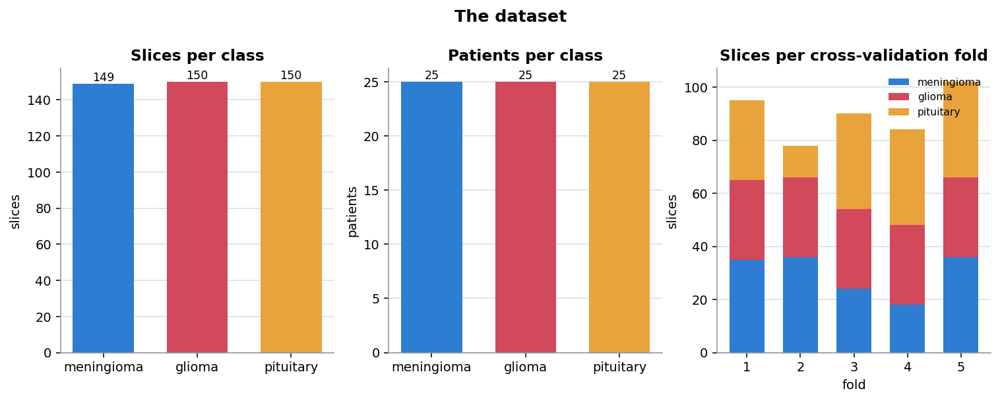
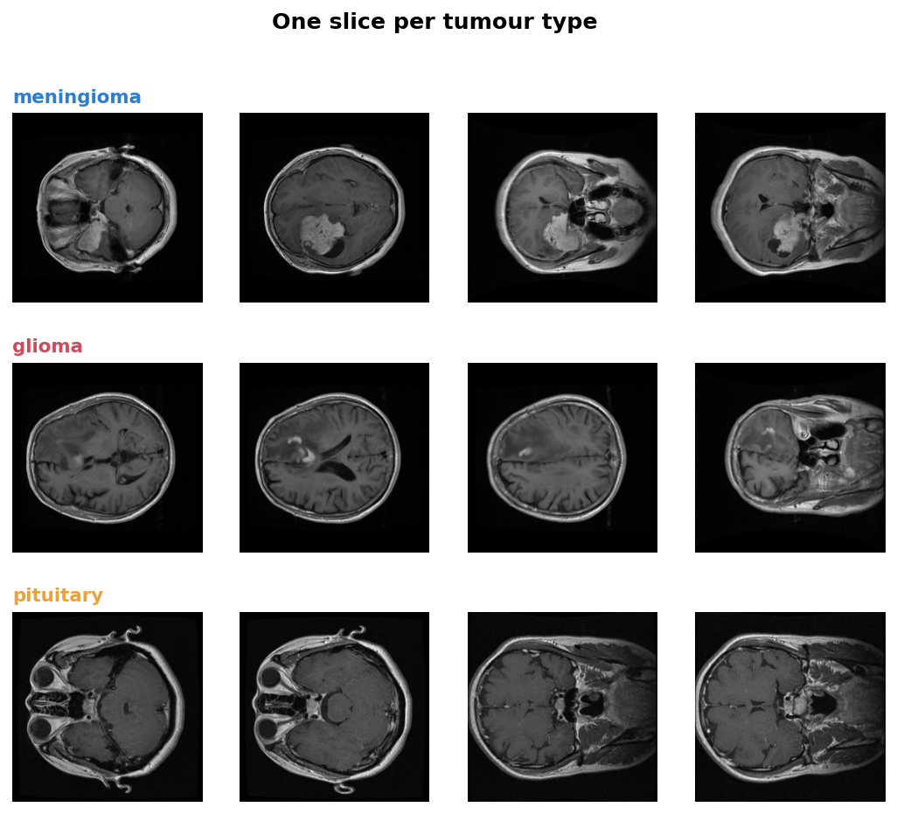
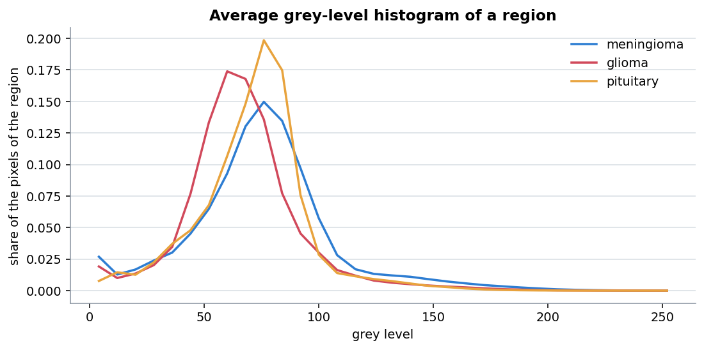
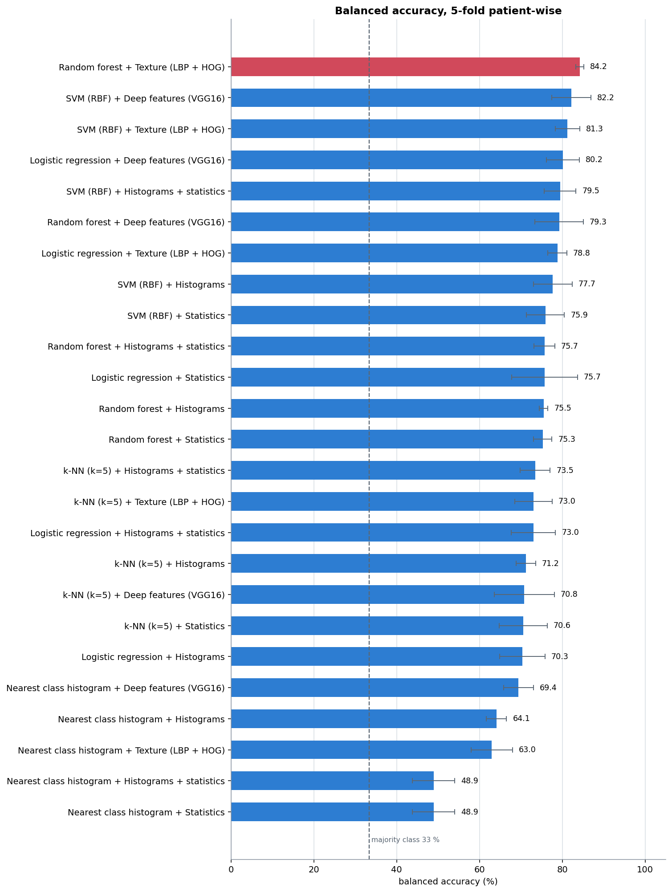
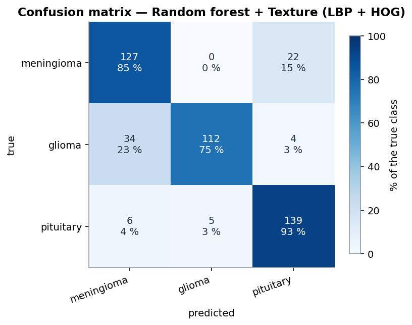
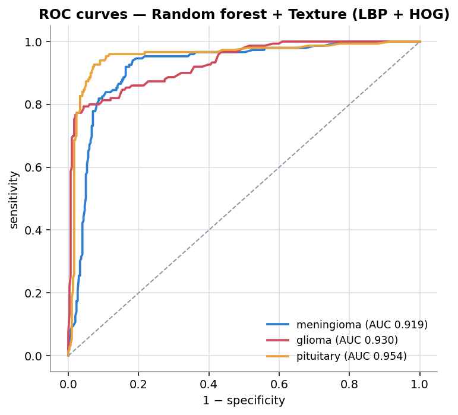
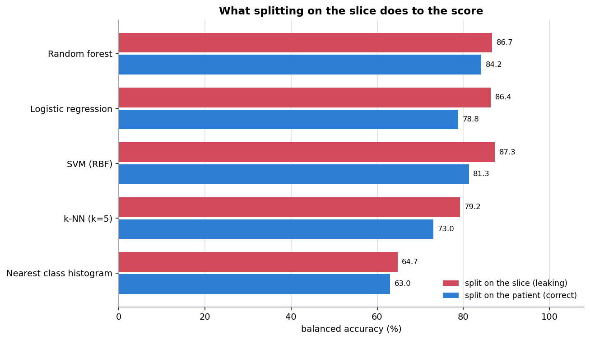

# Résultats

[🇬🇧 English](../results.md) · 🇫🇷 Français · [⬅ Retour au README](../../README.fr.md)

Tous les chiffres de cette page sont produits par les scripts de
[`scripts/`](../../scripts), sur les coupes de [`data/`](../../data). Pour les reproduire :

```bash
python scripts/02_compare_models.py --with-deep
python scripts/03_leakage_demo.py
```

Les tableaux bruts sont écrits dans [`results/`](../../results).

## 1. Le jeu de données



| | |
|---|---|
| Coupes | 449 |
| Patients | 75 (25 par classe) |
| Coupes par patient | 5 ou 6 |
| Classes | méningiome 149, gliome 150, pituitaire 150 |
| Plis | 5, selon la répartition publiée avec le jeu de données |
| **Patients à cheval sur plusieurs plis** | **0** |
| Référence de la classe majoritaire | 33,4 % |



Les trois types sont visiblement différents : un méningiome siège au bord du cerveau et
s'illumine après injection, un gliome se développe dans le tissu avec un bord moins net, et
une tumeur pituitaire est petite, centrale et à une position très constante.

## 2. Y a-t-il un signal dans les seuls niveaux de gris ?



L'histogramme moyen de la région centrale diffère entre les classes, mais les courbes se
recouvrent largement. Toute la situation tient dans cette image : il **y a** du signal dans
les intensités, assez pour qu'une règle simple batte le hasard, mais pas assez pour séparer
proprement les classes. Tout ce qui dépasse le modèle le plus simple consiste à en extraire
davantage.

## 3. Les 25 combinaisons

Cinq jeux de descripteurs × cinq classifieurs, tous sur les mêmes plis par patient.



### Meilleur classifieur pour chaque jeu de descripteurs

| Descripteurs | Taille | Meilleur classifieur | Accuracy équilibrée | F1 macro | AUC |
|---|---|---|---|---|---|
| **Texture (LBP + HOG)** | 1 924 | **Forêt aléatoire** | **84,2 % ± 1,0** | **0,842** | **0,935** |
| Caractéristiques VGG16 | 512 | SVM (RBF) | 82,2 % ± 4,7 | 0,822 | 0,929 |
| Histogrammes + statistiques | 592 | SVM (RBF) | 79,5 % ± 3,8 | 0,793 | 0,907 |
| Histogrammes | 512 | SVM (RBF) | 77,7 % ± 4,7 | 0,774 | 0,899 |
| Statistiques d'intensité | 80 | SVM (RBF) | 75,9 % ± 4,6 | 0,758 | 0,895 |

Le ± est l'écart-type de l'accuracy équilibrée sur les cinq plis.

### Meilleur jeu de descripteurs pour chaque classifieur

| Classifieur | Meilleurs descripteurs | Accuracy équilibrée |
|---|---|---|
| Forêt aléatoire | Texture | 84,2 % |
| SVM (RBF) | Caractéristiques profondes | 82,2 % |
| Régression logistique | Caractéristiques profondes | 80,2 % |
| k-NN (k=5) | Histogrammes + statistiques | 73,5 % |
| Plus proche moyenne | Caractéristiques profondes | 69,4 % |

### Trois choses que dit ce tableau

**La texture bat les caractéristiques profondes.** 84,2 % contre 82,2 %, avec un quart de
la dispersion entre plis (±1,0 contre ±4,7). Sur 449 images, un descripteur compact conçu
pour le problème généralise mieux que les activations d'un réseau entraîné sur des
photographies. Avec quelques milliers de coupes, le classement s'inverserait très
probablement — c'est un résultat sur *cette taille de jeu de données*, pas sur
l'apprentissage profond.

**Les descripteurs comptent plus que le classifieur.** L'écart entre le meilleur et le pire
jeu de descripteurs, pour le même SVM, est de 6,2 points. L'écart entre le meilleur et le
pire classifieur sur les mêmes descripteurs de texture est de 21 points — mais cet écart
est dominé par la plus proche moyenne, qui est une référence volontairement naïve. Entre
les quatre vrais classifieurs, l'écart se réduit à 11 points.

**La règle naïve n'est pas inutile.** La plus proche moyenne atteint 63 à 69 % selon les
descripteurs, contre une référence à 33,4 %. L'idée d'où est parti le projet fonctionne ;
elle est simplement battue par tout ce qui est venu ensuite, et c'est ce qui rend la
comparaison digne d'être publiée.

## 4. Le meilleur modèle en détail

**Forêt aléatoire sur descripteurs de texture** — 84,2 % d'accuracy équilibrée, F1 macro
0,842, AUC 0,935.

| Classe | Effectif | Sensibilité | Spécificité | Précision | F1 |
|---|---|---|---|---|---|
| Méningiome | 149 | 85,2 % | 86,7 % | 0,760 | 0,804 |
| Gliome | 150 | 74,7 % | **98,3 %** | 0,957 | 0,839 |
| Pituitaire | 150 | **92,7 %** | 91,3 % | 0,842 | 0,883 |

<p align="center">


</p>

### Lire la matrice de confusion

```text
                   prédit
              mén.  gli.  pit.
vrai  mén.    127     0    22
      gli.     34   112     4
      pit.      6     5   139
```

Les erreurs sont **asymétriques**, et c'est là tout l'intérêt.

- **34 gliomes sont annoncés comme méningiomes, et aucun méningiome n'est jamais annoncé
  comme gliome.** Le modèle ne dit « gliome » que lorsqu'il est sûr : spécificité 98,3 %,
  précision 0,957 — quand il dit gliome, il a raison 96 fois sur 100. Le prix à payer est
  qu'il manque un gliome sur quatre.
- **22 méningiomes sont annoncés comme tumeurs pituitaires.** Les deux sont extra-axiaux —
  hors du tissu cérébral — et un méningiome proche de la base du crâne siège près de
  l'endroit où se trouverait une tumeur pituitaire.
- **Les tumeurs pituitaires sont la classe la plus facile**, 92,7 % de sensibilité, parce
  que leur position est quasi constante.

En contexte clinique, le comportement sur le gliome serait le mauvais compromis : un gliome
manqué est plus grave qu'une fausse alerte. Déplacer le seuil de décision échangerait de la
spécificité contre de la sensibilité, ce que les courbes ROC rendent explicite.

## 5. Le coût d'une mauvaise séparation

Même code, avec une séparation aléatoire des coupes au lieu des patients.



| Classifieur | Par patient | Par coupe | Gonflement |
|---|---|---|---|
| Plus proche moyenne | 63,0 % | 64,7 % | +1,8 |
| k-NN (k=5) | 73,0 % | 79,2 % | **+6,2** |
| SVM (RBF) | 81,3 % | 87,3 % | **+6,0** |
| Régression logistique | 78,8 % | 86,4 % | **+7,6** |
| Forêt aléatoire | 84,2 % | 86,7 % | +2,5 |
| | | **moyenne** | **+4,8** |

La séparation aléatoire partage **68 des 75 patients** entre entraînement et test.

Deux observations à retenir :

**Le gain est le plus fort pour les modèles qui mémorisent.** Le k-NN bondit de 6,2
points : avec une quasi-copie de l'image de test dans le jeu d'entraînement, trouver les 5
plus proches voisins devient trivial. La plus proche moyenne bouge à peine, parce que
moyenner toute une classe efface les images individuelles — elle ne peut pas mémoriser,
donc elle ne peut pas tricher.

**Rien dans la sortie ne l'aurait signalé.** L'exécution par coupe produit un propre
87,3 %, une matrice de confusion d'allure raisonnable et une courbe ROC plausible. Le seul
moyen de le savoir est d'avoir séparé correctement dès le départ : c'est pourquoi le
contrôle est intégré au code et affirmé dans les tests, plutôt que laissé à la discipline.

## 6. Comment lire ces chiffres

- **84,2 % n'est pas un résultat clinique.** Avec 75 patients, l'intervalle de confiance
  couvre plusieurs points, et toutes les données viennent de deux hôpitaux avec un seul
  protocole.
- **Le classement est plus solide que les valeurs.** La texture devant les caractéristiques
  profondes, et les deux devant les simples histogrammes, est cohérent pour les cinq
  classifieurs.
- **Ce sont les métriques par classe qu'il faut lire.** Le 84,2 % affiché masque qu'un
  gliome sur quatre est manqué.
- **Rien n'est optimisé ici.** Aucune recherche d'hyperparamètres n'a été menée : ce sont
  les scores de valeurs par défaut raisonnables, pas de modèles réglés. Un réglage dans la
  validation croisée les relèverait tous un peu, et changerait très peu le classement.

**Il s'agit d'un projet d'étude, pas d'un dispositif médical.** Il n'a fait l'objet d'aucune
validation clinique.
