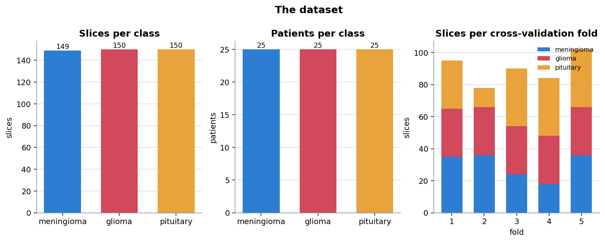
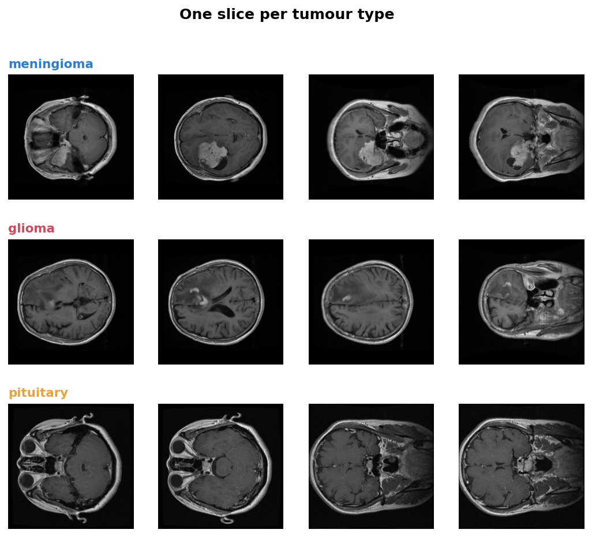
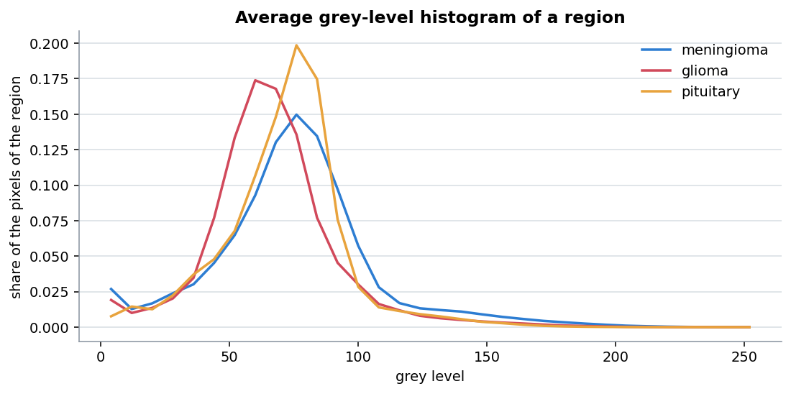
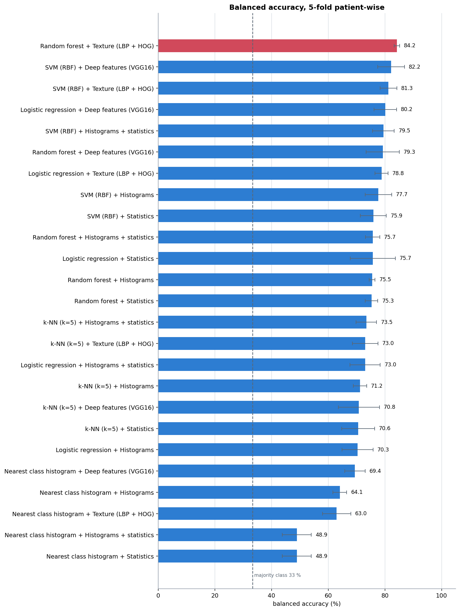
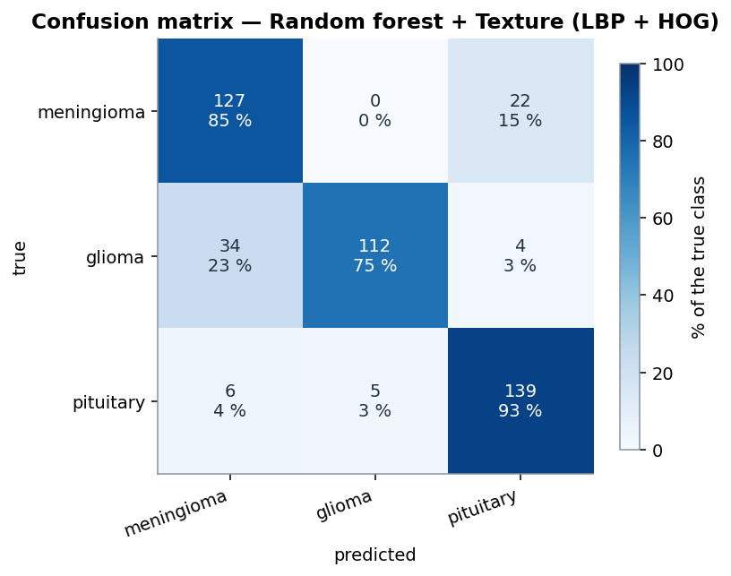
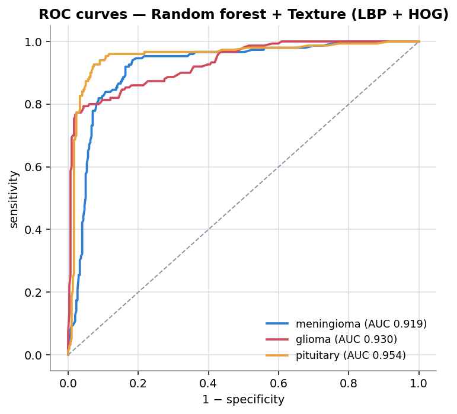
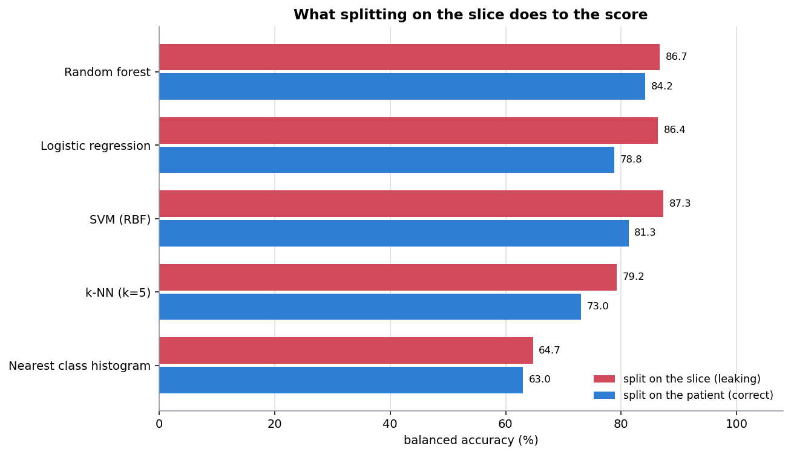

# Results

🇬🇧 English · [🇫🇷 Français](fr/resultats.md) · [⬅ Back to README](../README.md)

Every number here is produced by the scripts in [`scripts/`](../scripts), on the slices in
[`data/`](../data). To reproduce:

```bash
python scripts/02_compare_models.py --with-deep
python scripts/03_leakage_demo.py
```

The raw tables are written to [`results/`](../results).

## 1. The dataset



| | |
|---|---|
| Slices | 449 |
| Patients | 75 (25 per class) |
| Slices per patient | 5 or 6 |
| Classes | meningioma 149, glioma 150, pituitary 150 |
| Folds | 5, from the assignment published with the dataset |
| **Patients spanning more than one fold** | **0** |
| Majority-class baseline | 33.4 % |



The three types are visibly different: a meningioma sits at the edge of the brain and
lights up after contrast, a glioma grows inside the tissue with a less defined border, and
a pituitary tumour is small, central and at a very constant position.

## 2. Is there a signal in the grey levels alone?



The averaged histogram of the central region differs between classes, but the curves
overlap heavily. That is the whole situation in one picture: there **is** signal in the
intensities, enough for a simple rule to beat chance, but not enough to separate the
classes cleanly. Everything beyond the simplest model is about extracting more than this.

## 3. The 25 combinations

Five feature sets × five classifiers, all on the same patient-wise folds.



### Best classifier for each feature set

| Feature set | Size | Best classifier | Balanced accuracy | Macro F1 | AUC |
|---|---|---|---|---|---|
| **Texture (LBP + HOG)** | 1 924 | **Random forest** | **84.2 % ± 1.0** | **0.842** | **0.935** |
| Deep features (VGG16) | 512 | SVM (RBF) | 82.2 % ± 4.7 | 0.822 | 0.929 |
| Histograms + statistics | 592 | SVM (RBF) | 79.5 % ± 3.8 | 0.793 | 0.907 |
| Histograms | 512 | SVM (RBF) | 77.7 % ± 4.7 | 0.774 | 0.899 |
| Intensity statistics | 80 | SVM (RBF) | 75.9 % ± 4.6 | 0.758 | 0.895 |

The ± is the standard deviation of the balanced accuracy across the five folds.

### Best feature set for each classifier

| Classifier | Best features | Balanced accuracy |
|---|---|---|
| Random forest | Texture | 84.2 % |
| SVM (RBF) | Deep features | 82.2 % |
| Logistic regression | Deep features | 80.2 % |
| k-NN (k=5) | Histograms + statistics | 73.5 % |
| Nearest class mean | Deep features | 69.4 % |

### Three things this table says

**Texture beats deep features.** 84.2 % against 82.2 %, with a quarter of the spread
across folds (±1.0 against ±4.7). On 449 images, a compact descriptor built for the
problem generalises better than the activations of a network trained on photographs. With
a few thousand slices the ranking would very likely flip — this is a result about *this
dataset size*, not about deep learning.

**The features matter more than the classifier.** The spread between the best and worst
feature set, for the same SVM, is 6.2 points. The spread between the best and worst
classifier on the same texture features is 21 points — but that range is dominated by the
nearest class mean, which is a deliberately naive baseline. Among the four real
classifiers, the gap narrows to 11 points.

**The naive rule is not useless.** The nearest class mean reaches 63–69 % depending on the
features, against a 33.4 % baseline. The idea the project started from does work; it is
just beaten by everything that came after, which is what makes the comparison worth
publishing.

## 4. The best model in detail

**Random forest on texture features** — 84.2 % balanced accuracy, macro F1 0.842, AUC 0.935.

| Class | Support | Sensitivity | Specificity | Precision | F1 |
|---|---|---|---|---|---|
| Meningioma | 149 | 85.2 % | 86.7 % | 0.760 | 0.804 |
| Glioma | 150 | 74.7 % | **98.3 %** | 0.957 | 0.839 |
| Pituitary | 150 | **92.7 %** | 91.3 % | 0.842 | 0.883 |

<p align="center">


</p>

### Reading the confusion matrix

```text
                 predicted
              men.  gli.  pit.
true  men.    127     0    22
      gli.     34   112     4
      pit.      6     5   139
```

The errors are **asymmetric**, and that is the interesting part.

- **34 gliomas are called meningiomas, and no meningioma is ever called a glioma.** The
  model raises "glioma" only when it is confident: specificity 98.3 %, precision 0.957 —
  when it says glioma it is right 96 times out of 100. The cost is that it misses one
  glioma in four.
- **22 meningiomas are called pituitary tumours.** Both are extra-axial — outside the brain
  tissue — and a meningioma near the base of the skull sits close to where a pituitary
  tumour would be.
- **Pituitary tumours are the easiest class**, 92.7 % sensitivity, because their position
  is almost constant.

In a clinical setting the glioma behaviour would be the wrong trade-off: a missed glioma
matters more than a false alarm. Shifting the decision threshold would trade specificity
for sensitivity, which the ROC curves make explicit.

## 5. The cost of a wrong split

Running the same code with a random split of the slices instead of the patients.



| Classifier | Patient-wise | Slice-wise | Inflation |
|---|---|---|---|
| Nearest class mean | 63.0 % | 64.7 % | +1.8 |
| k-NN (k=5) | 73.0 % | 79.2 % | **+6.2** |
| SVM (RBF) | 81.3 % | 87.3 % | **+6.0** |
| Logistic regression | 78.8 % | 86.4 % | **+7.6** |
| Random forest | 84.2 % | 86.7 % | +2.5 |
| | | **mean** | **+4.8** |

The random split shares **68 of the 75 patients** between training and test.

Two observations worth keeping:

**The gain is largest for the models that memorise.** k-NN jumps 6.2 points: with a
near-copy of the test image in the training set, finding the 5 nearest neighbours becomes
trivial. The nearest class mean barely moves, because averaging a whole class throws the
individual images away — it cannot memorise, so it cannot cheat.

**Nothing in the output would have flagged it.** The slice-wise run produces a clean
87.3 %, a reasonable-looking confusion matrix and a plausible ROC curve. The only way to
know is to have split correctly in the first place, which is why the check is built into
the code and asserted in the tests rather than left to discipline.

## 6. How to read these numbers

- **84.2 % is not a clinical result.** With 75 patients, the confidence interval is several
  points wide, and all the data comes from two hospitals using one protocol.
- **The ranking is more solid than the values.** Texture ahead of deep features, and both
  ahead of plain histograms, is consistent across all five classifiers.
- **Per-class metrics are the ones to read.** The headline 84.2 % hides that one glioma in
  four is missed.
- **Nothing here is tuned.** No hyper-parameter search was run, so these are the scores of
  reasonable defaults, not of optimised models. Tuning inside the cross-validation would
  raise all of them somewhat, and change the ranking very little.

**This is a study project, not a medical device.** It has not been clinically validated.
